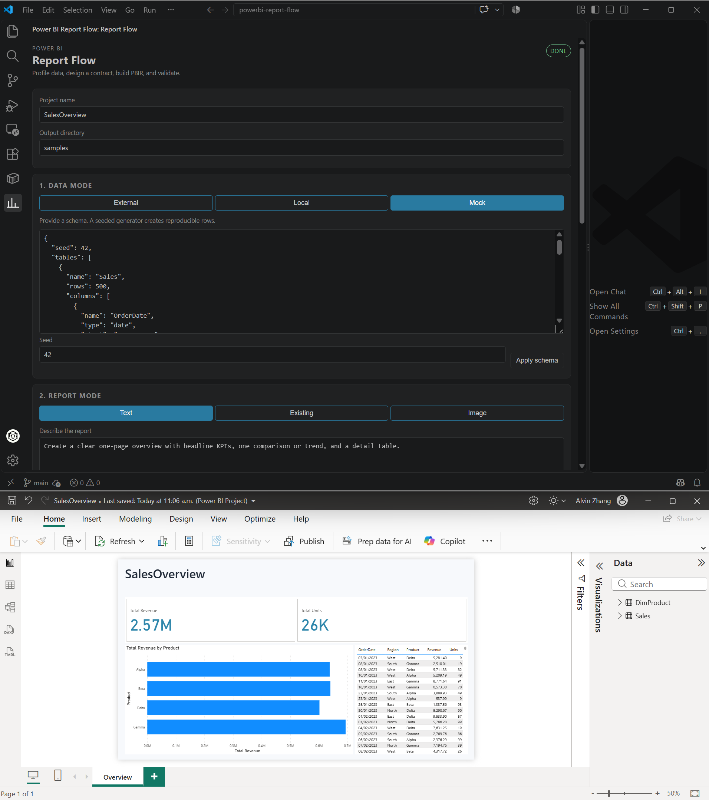

# Power BI Report Flow

A VS Code extension that runs a guided Power BI report pipeline from the Activity Bar:

**profile data → design a contract → approve → build [PBIP](https://learn.microsoft.com/en-us/power-bi/developer/projects/projects-overview)/[TMDL](https://learn.microsoft.com/en-us/analysis-services/tmdl/tmdl-overview)/[PBIR](https://learn.microsoft.com/en-us/power-bi/developer/projects/projects-report#power-bi-enhanced-report-format-pbir) → validate → preview**

It combines the official [Power BI Report Skill](https://learn.microsoft.com/en-us/power-bi/developer/agentic/power-bi-report-skill-overview), the [Power BI Authoring MCP Server](https://learn.microsoft.com/en-us/power-bi/developer/mcp/mcp-servers-overview), and the bundled [`powerbi-report-author` CLI](https://www.npmjs.com/package/@microsoft/powerbi-report-authoring-cli).



*The sidebar configures data/report modes and builds the PBIP; the generated `SalesOverview` sample is shown open in [Power BI Desktop](https://powerbi.microsoft.com/desktop/) after refresh.*

## Features

- **Data modes**
  - **External**: SQL Server, PostgreSQL, or MySQL profiling. [Fabric](https://learn.microsoft.com/en-us/fabric/) live-model configuration is present but MCP-backed Fabric authoring is a follow-up.
  - **Local**: CSV, TSV, XLSX, XLS, or JSON. The file is copied into the generated project.
  - **Mock**: JSON schema with a seeded generator for reproducible data.
- **Report modes**
  - **Text**: an LLM produces the canonical design contract; a deterministic fallback layout is used when no model is configured.
  - **Existing**: extracts page sizes, visuals, text, and theme colors from a [PBIR](https://learn.microsoft.com/en-us/power-bi/developer/projects/projects-report#power-bi-enhanced-report-format-pbir) `.Report` folder or `.pbip`.
  - **Image**: sends a PNG/JPEG/WebP to a vision-capable model and converts the detected layout into grid placements.
- **Approval gate**: `_brief/report-spec.md` and `_brief/design-brief.yaml` are written first; the build refuses to run until you approve. The approval stores a SHA-256 hash of the contract.
- **Generated project**
  - `.pbip`, `.Report/` with [PBIR](https://learn.microsoft.com/en-us/power-bi/developer/projects/projects-report#power-bi-enhanced-report-format-pbir) pages and visuals, `.SemanticModel/` with [TMDL](https://learn.microsoft.com/en-us/analysis-services/tmdl/tmdl-overview) tables and measures, `data/` CSVs.
  - `_brief/`, `validation/validate-result.json`, and a README.
  - [M-query](https://learn.microsoft.com/en-us/powerquery-m/) dimension tables (`DimRegion`, `DimProduct`, …) with many-to-one relationships from fact tables.
- **Validation**: runs [`powerbi-report-author validate`](https://www.npmjs.com/package/@microsoft/powerbi-report-authoring-cli) and surfaces errors/warnings in the sidebar.
- **MCP verification**: when the EULA is accepted, the extension starts the local [Power BI Authoring MCP server](https://learn.microsoft.com/en-us/power-bi/developer/mcp/mcp-servers-overview), loads the generated TMDL, and reports table/measure counts.
- **Preview**: detects [Power BI Desktop](https://powerbi.microsoft.com/desktop/) through the report CLI (including Microsoft Store/MSIX installs), opens the generated `.pbip` with the desktop bridge if needed, and captures page screenshots. Without Desktop it reports a clear *blocked* state instead of pretending the report was verified.

## Model compatibility rules

The [TMDL](https://learn.microsoft.com/en-us/analysis-services/tmdl/tmdl-overview) writer is deliberately conservative because [PBIP](https://learn.microsoft.com/en-us/power-bi/developer/projects/projects-overview)/TMDL import is stricter than the [PBIR](https://learn.microsoft.com/en-us/power-bi/developer/projects/projects-report#power-bi-enhanced-report-format-pbir) schema:

- TMDL files are always written with **CRLF** line endings. [Power BI Desktop](https://powerbi.microsoft.com/desktop/)'s TMDL reader opens a blank `Untitled` window for LF-only files.
- Generated models set `defaultPowerBIDataSourceVersion: powerBI_V3`.
- **`isKey` is never written.** Power BI Desktop has no general primary-key concept; a column marked `isKey` makes **Refresh** fail with `Non-null assertion failure: query`. A post-build check also strips any `isKey` line that bypasses the writer.
- CSV `File.Contents` paths use single backslashes; [M](https://learn.microsoft.com/en-us/powerquery-m/) string literals do not use backslash escapes.
- Auto dimensions use [M-query](https://learn.microsoft.com/en-us/powerquery-m/) `Table.Distinct` partitions, not [DAX](https://learn.microsoft.com/en-us/dax/) calculated tables. Power BI Desktop 2.159 cannot reopen a PBIP whose relationship targets a calculated table, even when Desktop itself created that relationship.

## Tested environments

| Environment | Notes |
|---|---|
| Local Windows development | Windows 11, VS Code 1.143, Node 24 (bundled runtime), Power BI Desktop 2.159 (Microsoft Store/MSIX). End-to-end mock/local/report flow, CLI validation, MCP load, and preview screenshots were exercised. |
| [Strata](https://github.com/Niko1221/Strata) local LLM runtime (operator test environment) | Strata is a free/open-source local LLM app and inference engine, **not** a database or SQL endpoint. It exposes OpenAI/Anthropic-compatible APIs on localhost; run `strata connect` for the exact base URL. Use it as the optional LLM backend for text/existing/image report modes; External SQL data mode remains separate. Model files, endpoints, and keys stay outside this repository. |

## Requirements

- VS Code 1.100 or newer (tested on 1.141 and 1.143).
- Windows x64 for the bundled Power BI Authoring MCP binary; other platforms fall back to the `node_modules` wrapper when present.
- Node.js 20+ for the extension host.
- The report CLI and MCP are bundled into `dist/tools` at build time; a source checkout also needs `pnpm install`.
- Optional: Power BI Desktop for rendered preview/screenshots.
- Optional: GitHub Copilot Chat, an OpenAI-compatible API key, or a local [Strata](https://github.com/Niko1221/Strata) runtime for LLM-assisted design.

### Optional local LLM with Strata

[Strata](https://github.com/Niko1221/Strata) is an open-source local LLM runtime for Windows/Linux/macOS. It is **not** a SQL database; it exposes an OpenAI-compatible API on localhost for the extension's text/existing/image design steps.

1. Install Strata and start a model, then run `strata connect` to get the local API base URL.
2. Set `powerbiFlow.llm.provider` to `openai`.
3. Set `powerbiFlow.llm.baseUrl` to the Strata base URL (for example `http://127.0.0.1:<port>/v1`).
4. Set `powerbiFlow.llm.model` to the model name reported by Strata.
5. If Strata requires an API key, run **Power BI: Set OpenAI-compatible API Key**.

Image mode additionally requires a model that accepts image input. Endpoints, model files, and keys are not stored in this repository.

## Local deployment

### Install a locally built VSIX

```bash
pnpm install
pnpm typecheck
pnpm test
pnpm build
pnpm package
code --install-extension powerbi-report-flow-0.1.0.vsix
```

Reload VS Code, open the **Power BI Report Flow** view in the Activity Bar, then run **Power BI: Check Dependencies**. This is the recommended deployment for a single machine or an internal network share; no Marketplace account is required.

### Run from source (F5)

```bash
pnpm install
pnpm typecheck
pnpm test
pnpm build
```

Open this folder in VS Code and press **F5**. In the Extension Development Host, open the **Power BI Report Flow** Activity Bar view.

> This repository uses a hoisted `node_modules` layout (`.npmrc`) because the report CLI and MCP server resolve their dependencies at runtime. `pnpm build` bundles the CLI into `dist/tools`, copies the Windows MCP executable into `dist/tools/mcp`, and bundles the desktop bridge, so an installed VSIX does not need `node_modules`.

## Configuration

| Setting | Default | Purpose |
|---|---|---|
| `powerbiFlow.outputDir` | `powerbi-flow` | Workspace-relative output folder |
| `powerbiFlow.llm.provider` | `copilot` | `copilot` or `openai` |
| `powerbiFlow.llm.model` | empty | Optional model id |
| `powerbiFlow.llm.baseUrl` | OpenAI URL | OpenAI-compatible base URL |
| `powerbiFlow.llm.visionModel` | empty | Optional vision model for image mode |
| `powerbiFlow.preview.host` | `auto` | `auto`, `desktop`, or `none` |
| `powerbiFlow.mock.maxRows` | `50000` | Maximum mock rows per table |
| `powerbiFlow.model.autoDimensions` | `true` | Add M-query dimension tables and relationships |
| `powerbiFlow.mcp.eulaAccepted` | `false` | Enables the MCP verification step |

Store an OpenAI-compatible key with **Power BI: Set OpenAI-compatible API Key**. It is kept in VS Code SecretStorage and never written to the project.

## Typical flow

1. Open the Activity Bar view.
2. Choose **Mock** (or Local/External) and a report mode.
3. For mock data, edit the JSON schema and click **Apply schema**.
4. For text mode, describe the report. For image/existing mode, select the input.
5. Click **Generate spec**. Review `_brief/report-spec.md`.
6. Click **Approve & build**.
7. Click **Validate**. If Power BI Desktop is installed, click **Preview / screenshots**.
8. Generated project is under `powerbi-flow/<ProjectName>/`.

## Sample project

`samples/SalesOverview` is generated by `scripts/smoke.ts`. The generated sample is git-ignored because TMDL `File.Contents` embeds an absolute local path; regenerate it locally:

```bash
node node_modules/vite-node/vite-node.mjs scripts/smoke.ts
node dist/tools/report-cli.mjs validate samples/SalesOverview/SalesOverview.Report --pretty
```

When you open the `.pbip` in Power BI Desktop the visuals are blank until the first refresh; click **Refresh now** once to load the CSV.

## Privacy and security

- No telemetry. The extension has no analytics endpoint and does not phone home.
- Data stays local. Profiling and generated files are written only under the workspace/output directory (plus VS Code global storage for MCP audit logs).
- API keys are stored in VS Code SecretStorage. Database passwords are used in memory for profiling and are not written to PBIP.
- When an LLM is configured, the design brief, schema, and reference/image data needed for the selected mode are sent to that provider. Use a local/approved endpoint for sensitive data.
- Before publishing a generated project, review TMDL/PBIR for server names, file paths, and sample values.
- See `SECURITY.md` and `PRIVACY.md`. Run `pnpm privacy:check` before publishing.

## Publishing to your own git repository

The repository is prepared for a local-first release; no remote is configured. After reviewing the tree:

```bash
git status
git add -A
git commit -m "Power BI Report Flow 0.1.0"
git remote add origin <your-repo-url>
git branch -M main
git push -u origin main
git tag v0.1.0
git push origin v0.1.0
```

Do not commit `.vsix`, `node_modules/`, `dist/`, `tmp/`, or generated `samples/` output. See `docs/publishing.md` for the full checklist.

## Current limitations

- Fabric live-model authoring through MCP is not wired into the UI flow yet; the data mode reports an actionable message.
- Image mode depends on a vision-capable model. If the configured model cannot accept images, the extension reports the failure.
- Without Power BI Desktop, rendered preview and screenshot review are **blocked**; structural PBIR validation still works.
- Preview accepts the classic installer path and Microsoft Store/MSIX installs. If Desktop already has the report open, the screenshot reflects the current window; if the window has unsaved changes, the extension warns instead of blocking the capture.
- Fabric publish/download/rebind is intentionally out of scope for this release.
- Custom visuals are not generated.

## License

MIT. The bundled report skill is from [`microsoft/skills-for-fabric`](https://github.com/microsoft/skills-for-fabric) (MIT). The Power BI tooling packages retain their own licenses.
